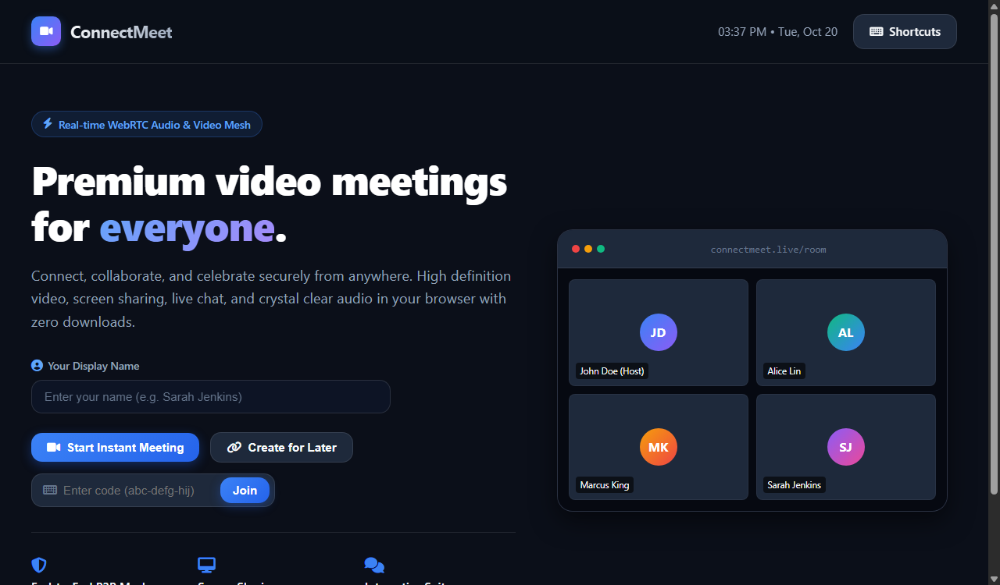
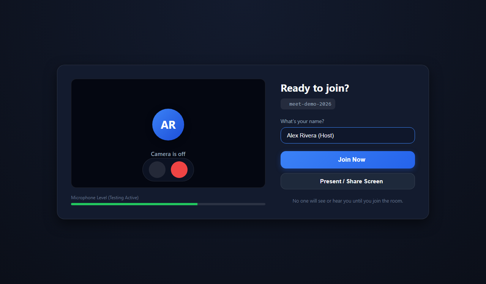
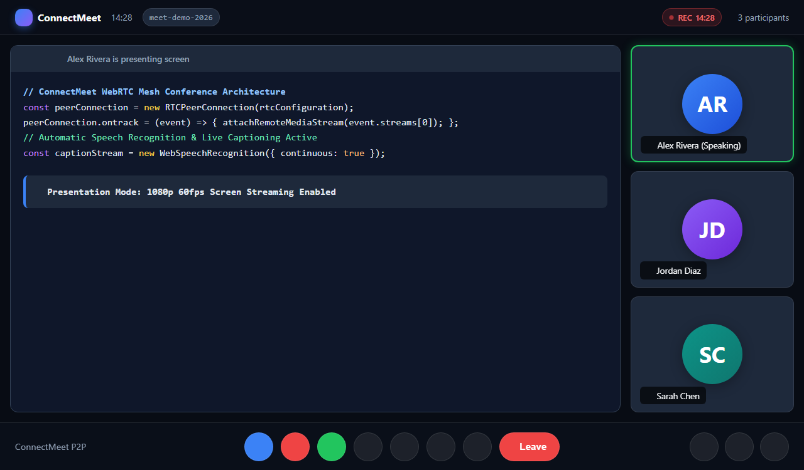
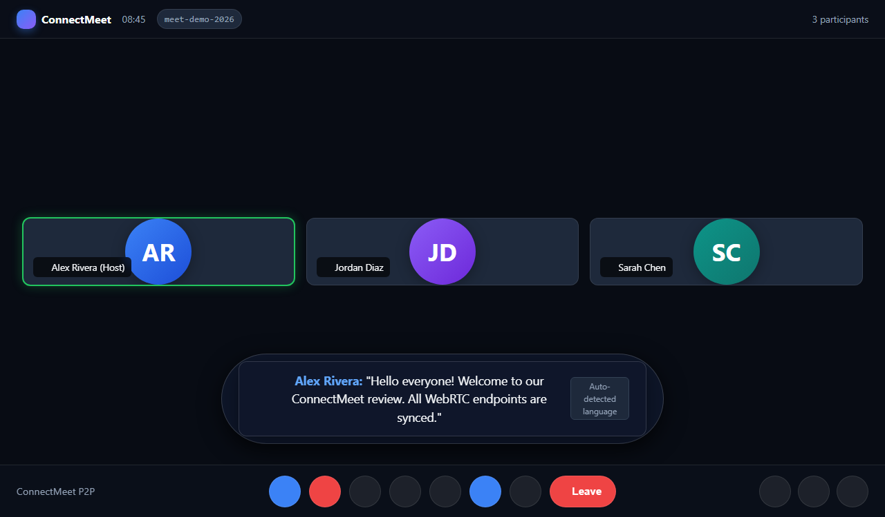
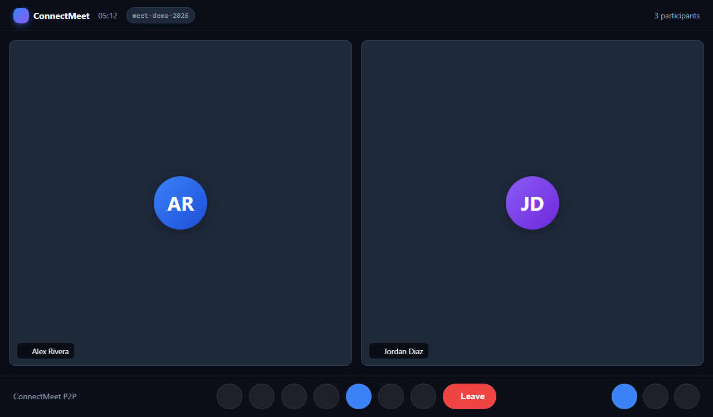
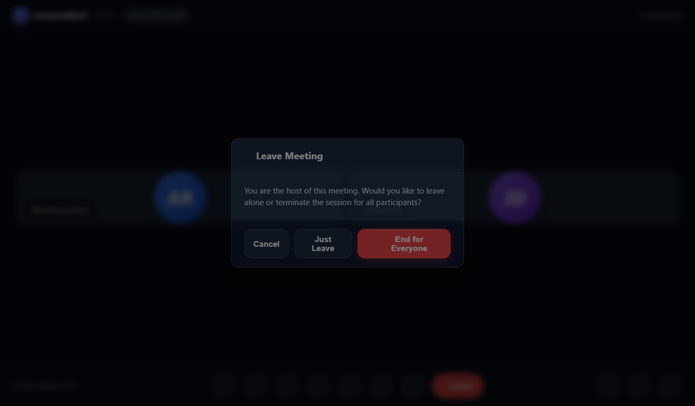

# ConnectMeet - Web-Based Video Conferencing System
Google Meet-style peer-to-peer (P2P) video conferencing with native WebRTC, real-time chat, screen sharing, and automatic live captions.

## 快速开始（XAMPP）
1. 把项目文件夹放在 `C:\xampp\htdocs\google_meet`
2. 启动 XAMPP 的 **Apache** 和 **MySQL**
3. 复制 `config/config.example.php` 为 `config/config.php` 并配置你的 MySQL 数据库凭据
4. 打开命令行运行初始化数据库脚本：
   ```bash
   php scripts/init_db.php
   ```
5. 打开浏览器访问：http://localhost/google_meet/
6. 点击 **Start an instant meeting**（发起即时会议）或输入会议代码
7. 在大厅（Lobby）测试摄像头与麦克风，点击 **Join Now** 进入会议
8. 复制会议链接或代码分享给同局域网或不同浏览器窗口的参会者加入
9. 在会议中体验屏幕共享、自动检测语言的实时字幕、聊天互动、表情雨以及主持人全员结束会议功能

## Features
- **Zero Framework / Zero Build Step**: 100% Native PHP 8.2+ backend and Vanilla JavaScript frontend.
- **WebRTC Peer-to-Peer Mesh**: Low-latency direct media streaming between participants with STUN fallback.
- **Instant & Scheduled Meetings**: Generates standard Google Meet format codes (`abc-defg-hij`).
- **Pre-Meeting Lobby (Green Room)**: Live camera preview, microphone volume level meter, and device selection.
- **Full Screen Sharing**: High-resolution screen, tab, or window presentation with participant overlays.
- **Smart Live Captions**: Continuous Web Speech API transcription with automatic language detection (no manual language selector needed; private view per participant).
- **Interactive In-Call Chat & Reactions**: Sanitized real-time chat with unread badges, hand raising, and animated floating emoji reactions.
- **Host Administration & Moderation**: Secure host tokens, room lock/unlock, kick participant, and **"End Meeting for Everyone"** broadcast.
- **Local Browser Recording**: Native `MediaRecorder` recording with persistent REC indicator and immediate `.webm` download.
- **Automated Verification Suite**: Built-in 24-point backend test script (`tests/test_api.php`).

## Screenshots

| Home Page | Pre-Meeting Lobby |
|:---:|:---:|
|  |  |

| Screen Sharing Presentation | Automatic Live Captions |
|:---:|:---:|
|  |  |

| Video Mesh & Real-Time Chat | Host Controls & End for Everyone |
|:---:|:---:|
|  |  |

## Folder structure
```
google_meet/
├── api/
│   ├── chat.php              # Real-time meeting chat & message retrieval
│   ├── heartbeat.php         # Participant presence & keep-alive
│   ├── meeting.php           # Room creation, validation, lock & end meeting
│   ├── reactions.php         # Synchronized floating emoji reactions & hand raises
│   └── signaling.php         # WebRTC SDP offer, answer & ICE candidate exchange
├── assets/
│   ├── css/
│   │   ├── responsive.css    # Mobile, tablet & desktop responsive breakpoints
│   │   └── style.css         # Core design system, video stage, drawer & control tokens
│   └── js/
│       ├── app.js            # Landing page meeting creation & join code validation
│       ├── meeting.js        # Stage orchestrator, captions, chat, reactions & UI controls
│       ├── settings.js       # Audio/video device selector & test speaker
│       ├── signaling.js      # Polling-based signaling client (offers, answers, ICE)
│       └── webrtc.js         # WebRTC peer connection mesh manager & screen sharing
├── config/
│   ├── config.example.php    # Clean configuration template for git
│   ├── config.php            # Local application config & database credentials (gitignored)
│   └── database.php          # Database helper class
├── database/
│   ├── install.sql           # Schema definition (meetings, participants, signaling, chat, etc.)
│   └── schema.sql            # Core database tables & indices
├── docs/
│   └── screenshots/          # Clean project screenshots (zero human faces / avatar UI)
├── includes/
│   ├── bootstrap.php         # Application initialization & config loader
│   ├── db.php                # PDO connection singleton & error handler
│   └── helpers.php           # UUID generators, input sanitization & JSON helpers
├── scripts/
│   └── init_db.php           # CLI script to automatically set up the database
├── tests/
│   └── test_api.php          # 24-point automated test suite for all endpoints
├── index.php                 # Home page (New meeting & Join code)
├── room.php                  # Pre-call green room (Lobby) & live conference room
├── LICENSE                   # Open-source MIT License
└── README.md                 # Project documentation
```

## 1. XAMPP setup
1. Clone or extract the project to:
   `C:\xampp\htdocs\google_meet`
2. Start **Apache** and **MySQL** in XAMPP Control Panel.
3. If not already present, create `config/config.php` from `config/config.example.php`:
   ```php
   'db' => [
       'host' => '127.0.0.1',
       'port' => 3306,
       'name' => 'connectmeet_db',
       'user' => 'root',
       'pass' => '', // or your MySQL password
       'charset' => 'utf8mb4',
   ],
   ```
4. Run database initialization from terminal:
   ```bash
   php scripts/init_db.php
   ```
5. Run automated test suite to ensure signaling and database integrity:
   ```bash
   php tests/test_api.php
   ```
   *(Expected output: `ALL 24 TESTS PASSED! API is fully operational.`)*
6. Open your browser: http://localhost/google_meet/

## 2. Starting & Joining Meetings
- **Start an instant meeting**: Click the **New meeting** dropdown on the homepage and select **Start an instant meeting**. You are assigned host privileges and automatically redirected to the Lobby.
- **Create a meeting for later**: Generates a shareable meeting URL and code without immediately entering.
- **Join with code**: Paste an existing room code (e.g., `abc-defg-hij`) or the full URL into the input box and click **Join**.

## 3. Pre-Meeting Lobby (Green Room)
Before entering the live video room:
- **Audio & Video Check**: Live preview of your camera and a responsive microphone audio activity bar.
- **Hardware Controls**: Toggle mic/camera on or off before entering.
- **Display Name**: Set your participant nickname (saved in localStorage for future visits).
- **Direct Entry Modes**:
  - **Join now**: Enters directly with your configured camera/microphone state.
  - **Present**: Automatically starts browser screen selection upon joining.

## 4. Screen Sharing & Video Grid
- **Auto-adaptive Mesh**: Dynamic video grid dynamically rearranges for 1, 2, 3-4, 5-6, and up to 8 participants.
- **Full Screen Sharing**: Clicking the **Present now** button opens the browser display picker. ConnectMeet uses WebRTC `replaceTrack` to broadcast your desktop, window, or Chrome tab in high definition to all peers.
- **Active Speaker Detection**: Real-time Web Audio API frequency analysis highlights the border of the person speaking.
- **Camera-Off Mode**: Participants who turn off video display a modern high-contrast initials avatar.

## 5. Live Captions (Auto Language Detection)
- **Zero Configuration**: No manual language selection required. The Web Speech API automatically transcribes speech in real time.
- **Privacy by Design**: Live captions are rendered locally on each participant's screen when toggled on. If a participant turns captions off, captions are not displayed on their screen.
- **Intelligent Visibility**: The subtitle overlay only appears when speech is detected, keeping the video stage clean.

## 6. Host Controls & End for Everyone
- **Host Privileges**: The user who creates the meeting is issued a cryptographically secure host token.
- **Lock Room**: Host can lock the room from the settings modal to prevent new participants from joining.
- **End Meeting for Everyone**:
  - When the host clicks **Leave call**, a choice appears: **"Just leave"** or **"End meeting for all"**.
  - Selecting **"End meeting for all"** broadcasts a shutdown event through the signaling database. All active participants immediately receive the event and their browser gracefully disconnects and redirects back to the home page with a notification.

## System flow
1. **Meeting Creation**: Host requests `api/meeting.php?action=create`. Room record and host token are stored in `meetings`.
2. **Lobby & Pre-flight**: User verifies media devices locally via `navigator.mediaDevices.getUserMedia()`.
3. **Join & Registration**: `api/meeting.php?action=join` registers participant in `participants` table and returns a unique `participant_id`.
4. **Signaling Exchange**:
   - Clients poll `api/signaling.php` every 1 second.
   - WebRTC SDP Offers, Answers, and ICE Candidates are routed point-to-point via `signaling_messages`.
   - Direct P2P `RTCPeerConnection` streams are established between all peers.
5. **Presence & Heartbeat**: Every 3 seconds, `api/heartbeat.php` updates participant timestamps. Stale participants are automatically timed out.
6. **Chat & Reactions**: Synchronized in real time through lightweight polling on `api/chat.php` and `api/reactions.php`.
7. **Meeting Termination**: Host triggers `api/meeting.php?action=end`. Room status updates to `ended`, terminating all peer connections.

## Security notes
- **PDO Prepared Statements**: 100% of database interactions use parameterized queries to prevent SQL injection.
- **XSS Sanitization**: Chat messages and participant names are sanitized and HTML-encoded before DOM insertion.
- **Host Token Authentication**: Administrative actions (locking, kicking, ending meeting) verify the host secret token.
- **Privacy Protection**: Database passwords and credentials in `config/config.php` are excluded via `.gitignore`.
- **Clean Signaling Lifecycle**: Signaling payloads and expired peer candidates are pruned to maintain high database throughput.

## License

This project is licensed under the [MIT License](LICENSE).
# google_meet

